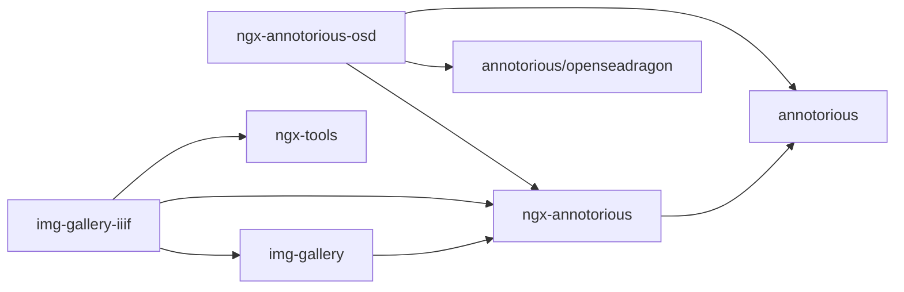

# NgxAnnotorious

This workspace contains a self-contained Angular wrapper for Annotorious V3, plus a couple of [Cadmus](https://myrmex.github.io/overview/cadmus)-related libraries depending on it.

To use the Annotorious wrapper you just need Annotorious, and no other dependency. Cadmus libraries are in this workspace for practical reasons, but also provide an example for using the library.

- [Angular Annotorious wrapper](./projects/myrmidon/ngx-annotorious/README.md): 📦 `@myrmidon/ngx-annotorious`.
- [Angular OSD Annotorious wrapper](./projects/myrmidon/ngx-annotorious-osd/README.md): 📦 `@myrmidon/ngx-annotorious-osd` (experimental).
- [Cadmus Image Gallery Brick](./projects/myrmidon/cadmus-img-gallery/README.md): 📦 `@myrmidon/cadmus-img-gallery`.
- [IIIF support for Cadmus Image Gallery Brick](./projects/myrmidon/cadmus-img-gallery-iiif/README.md): 📦 `@myrmidon/cadmus-img-gallery-iiif`.

## Quick Start

1. clone or download this repository.
2. install packages with `pnpm i`.
3. build libraries with `pnpm run build-lib` (the libraries depend on each other via `dist`, so they must be built in this order: `ngx-annotorious`, `ngx-annotorious-osd`, `cadmus-img-gallery`, `cadmus-img-gallery-iiif`).
4. run with `pnpm start`.
5. in the homepage, draw shapes and play with the annotations. In this demo, the custom model linked to each annotation is just a string, so the popup dialog allows you to enter it. Use the menus to access other functionalities, and the toolbar button to toggle the light/dark theme.

Tests use [Vitest](https://vitest.dev) via the Angular `unit-test` builder: run `pnpm test` for all the libraries, or `pnpm run test-ann`, `test-gal`, `test-iiif` for a single library in watch mode.

All the libraries are designed for **zoneless** Angular applications, with `OnPush` components and signal-based state; their styles only use Angular Material M3 system tokens (`--mat-sys-*`), so they follow the host application theme (light or dark).

## Dependencies

