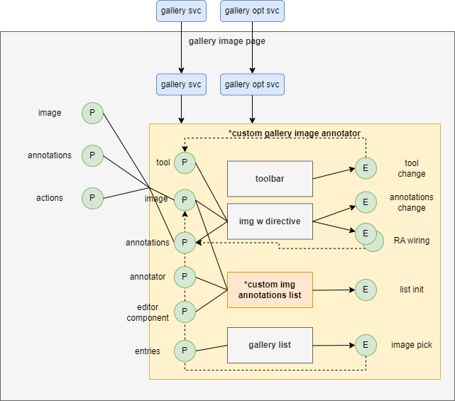

# CadmusImgGallery

📦 `@myrmidon/cadmus-img-gallery`

- [CadmusImgGallery](#cadmusimggallery)
  - [Overview](#overview)
  - [Annotation IDs](#annotation-ids)
  - [Usage](#usage)
    - [App Configuration](#app-configuration)
    - [Gallery Image Annotator](#gallery-image-annotator)
    - [Custom Image Annotation List](#custom-image-annotation-list)
  - [Services](#services)
  - [Components](#components)
  - [Setup](#setup)

## Overview

The image gallery is a minimalist set of components wrapping [Annotorious](https://annotorious.dev/) functionalities and used to:

- show a _gallery_ of images from some online source.
- let users _pick_ an image and _annotate_ it.

The idea is having a Cadmus part to _create annotations on images_. Once you create these annotations, you will be able to use other parts to _link_ them to any type of specialized data via their ID.

These components are independent from any specific _servicing technology_; images could be served by IIIF, cloud stores, etc.; you are free to provide your own service (implementing [GalleryService](./src/lib/services/mock-gallery.service.ts)) to get a page of images, and a single image, with the desired size. Even the _filters_ used to browse the list of images are totally open, so that you can define as many filters as you want, according to your own data.

## Annotation IDs

As usual in Cadmus, annotation IDs are opaque (and so they are supposed to be), just like items or parts IDs. Yet, at least in the context of the editor, more user-friendly IDs are welcome.

As explained [here](https://myrmex.github.io/overview/cadmus/dev/concepts/lookup), in other Cadmus parts, user friendly IDs are got via EID's (entity IDs); these are:

- aliases of entities which already have their own global ID (a GUID), like items;
- identifiers assigned to entities inside a part.

In both cases, they can be referenced via a lookup UI, where you just type some characters belonging to the ID to get a list of the first matching IDs. To apply the same approach in the context of image annotations, we define a **convention** by which you can _assign an EID to any annotation_ via a tag beginning with `eid_`. For instance, if you draw a rectangle around some region of an image, and assign it the tag `eid_sample`, by convention this means that the annotation linked to that region will get an EID equal to `sample`.

## Usage

Typically you create your own gallery component to orchestrate children components for the gallery list and its annotator. Thus, this is essentially a wrapper for lower level components.

To explain the usage of these components I will refer to the [example](../../../src/app/components/gallery-image-annotator-pg/gallery-image-annotator-pg.component.ts) page in this app.



### App Configuration

- 📁 [app.config.ts](../../../src/app/app.config.ts)

(1) ensure to configure `INDEX_LOOKUP_DEFINITIONS` if you are going to use **UI lookup components** targeting annotations IDs, e.g.:

```ts
// in appConfig:

// for lookup in asserted IDs - note that this would require a backend
const INDEX_LOOKUP_DEFINITIONS: IndexLookupDefinitions = {
  item_eid: {
    typeId: 'it.vedph.metadata',
    name: 'eid',
  }
};
```

(2) ensure to configure default **options for Material dialogs**, as annotations metadata are edited inside a popup, e.g.:

```ts
// in appConfig providers array:
{
  provide: MAT_DIALOG_DEFAULT_OPTIONS,
  useValue: {
    hasBackdrop: true,
    maxHeight: '800px',
  },
},
```

(3) configure the **gallery providers**, e.g.:

```ts
// in appConfig providers array:

// if you want to use the mock gallery, uncomment these two providers
// and comment the IIIF ones below.
// mock image gallery
// {
//   provide: IMAGE_GALLERY_SERVICE_KEY,
//   useClass: MockGalleryService,
// },
// {
//   provide: IMAGE_GALLERY_OPTIONS_KEY,
//   useValue: {
//     baseUri: '',
//     count: 50,
//     width: 300,
//     height: 400,
//   },
// },
// IIIF image gallery
{
  provide: IMAGE_GALLERY_SERVICE_KEY,
  useClass: SimpleIiifGalleryService,
},
{
  provide: IMAGE_GALLERY_OPTIONS_KEY,
  useValue: {
    baseUri: '',
    manifestUri:
      'https://dms-data.stanford.edu/data/manifests/Parker/xj710dc7305/manifest.json',
    arrayPath: 'sequences[0]/canvases',
    resourcePath: 'images[0]/resource',
    labelPath: 'label',
    width: 300,
    height: 400,
    targetWidth: 800,
    targetHeight: -1,
    pageSize: 6,
    // skip: 6
  } as SimpleIiifGalleryOptions,
},
```

### Gallery Image Annotator

- 📁 [gallery-image-annotator-pg.component.ts](../../../src/app/components/gallery-image-annotator-pg/gallery-image-annotator-pg.component.ts)

The demo page shows a tab with the gallery (`cadmus-gallery-list`), and a tab with the annotator. When an image is picked from the gallery (`imagePick`), the page gets it with the desired target size from the gallery service, and shows it in an `img` decorated with the `imgAnnotator` directive, side by side with a custom annotations list:

```html


<app-my-img-annotation-list
  [image]="img"
  [annotator]="ann.annotator()"
  [editorComponent]="editor"
  (listInit)="list.set($event)"
/>
```

```ts
protected async onImagePick(picked: GalleryImage): Promise<void> {
  const image = await firstValueFrom(
    this._galleryService.getImage(picked.id, this._options.get())
  );
  if (image) {
    this.image.set(image);
  }
}
```

The annotations (`ListAnnotation<T>`, where `T` is your payload model) are available from the list `annotations` signal.

### Custom Image Annotation List

The list of annotations is provided by a component derived from `ImgAnnotationListComponent<T>` (from `@myrmidon/ngx-annotorious`), or by the ready-made `ann-basic-img-annotation-list`. See the [ngx-annotorious documentation](../ngx-annotorious/README.md) for details.

## Services

A gallery image is any object implementing the `GalleryImage` interface, which provides the bare minimum properties of each image: a string ID, a URI, a title, and an optional short description.

Related services are:

- **gallery service** (`GalleryService`, provided via the `IMAGE_GALLERY_SERVICE_KEY` token). You provide your own real-world service, which might draw images from IIIF services, cloud services, etc. It has two methods: one to retrieve a page of images, and another to retrieve a single image, plus an optional `clearCache`.
- **gallery options service** (`GalleryOptionsService`), the singleton holding the gallery options, which are equal to or derive from `GalleryOptions`. The initial options are provided via the `IMAGE_GALLERY_OPTIONS_KEY` token. Use the `options` signal, `get`, `set` and `patch`.
- **gallery list repository** (`GalleryListRepository`), the signal-based store providing paged and filtered data to the gallery UI (`page`, `filter`, `loading`, `error`). It resets automatically when the options change.
- a **mock gallery service** (`MockGalleryService`), using an online mock images service. This is used during development as a placeholder for your custom service.
- **lorem ipsum service**, used by the mock gallery service to generate image descriptions.

The list of images in the gallery can be filtered using a `GalleryFilter`: a set of name/value pairs, both strings. For instance, to filter images by title you set a filter with name `title` and value equal to any portion of the title to match. The `filterGalleryImages` and `getDataPage` helpers can be used to implement simple in-memory services.

## Components

- **gallery filter** (`cadmus-gallery-filter`), to define any number of name=value pairs representing filters applied to the gallery images. When applied, the filter is set into the gallery list repository.
  - ➡️ `entries` (`GalleryFilterEntry[]`): the entries used to represent image metadata filters. Each entry is a metadatum, with ID=metadatum name and value=label. Cadmus thesaurus entries can be passed as they are. If not set, users can freely type a name rather than picking it from a list.
  - 🔃 `filter` (`GalleryFilter`): the filter being edited. When not set, the repository filter is shown.

- **gallery images list** (`cadmus-gallery-list`), to browse a list of images via the gallery service.
  - ➡️ `entries` (`GalleryFilterEntry[]`): the filter entries, as above.
  - ➡️ `filterVisible` (`boolean`, default true)
  - ➡️ `selectedId` (`string?`): the ID of the image to highlight as picked.
  - ➡️ `pageSizeOptions` (`number[]`)
  - ⬅️ `imagePick` (`GalleryImage`)

## Setup

To use this brick in your Cadmus frontend app:

(1) install the packages:

```bash
pnpm add @annotorious/annotorious @myrmidon/ngx-annotorious @myrmidon/cadmus-img-gallery
```

(2) add the Annotorious CSS styles to your `angular.json`:

```json
"styles": [
  "node_modules/@annotorious/annotorious/dist/annotorious.css",
  "src/styles.scss"
]
```

(3) provide the image service and default options in your app config (you can then change them later via `GalleryOptionsService`):

```ts
export const appConfig: ApplicationConfig = {
  providers: [
    // ...
    // image gallery: TODO replace with your own
    {
      provide: IMAGE_GALLERY_SERVICE_KEY,
      useClass: MockGalleryService,
    },
    {
      provide: IMAGE_GALLERY_OPTIONS_KEY,
      useValue: {
        baseUri: '',
        count: 50,
        width: 300,
        height: 400,
      },
    },
  ],
};
```

(4) if you want to lookup annotations by their EID, be sure to include the corresponding lookup definition like:

```ts
import { IndexLookupDefinitions } from '@myrmidon/cadmus-core';
import {
  GALLERY_IMAGE_ANNOTATIONS_PART_TYPEID,
} from '@myrmidon/cadmus-part-general-ui';

export const INDEX_LOOKUP_DEFINITIONS: IndexLookupDefinitions = {
  // ...
  // gallery
  img_anno_eid: {
    typeId: GALLERY_IMAGE_ANNOTATIONS_PART_TYPEID,
    name: 'eid',
  },
};
```
